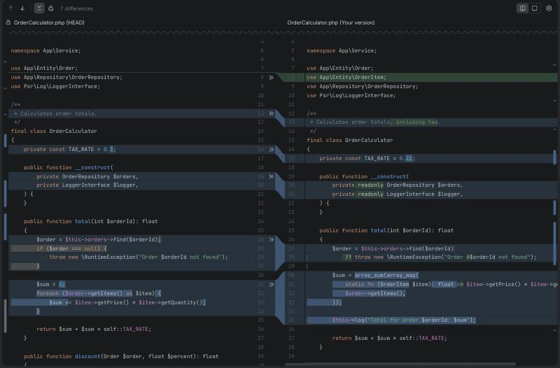

# ide-diff

A JetBrains-style diff & merge viewer for the web, built on [CodeMirror 6](https://codemirror.net/).

The diff and merge algorithms, the viewer behaviour, the colors and the icons are ported from the
[JetBrains IntelliJ Platform (intellij-community)](https://github.com/JetBrains/intellij-community)
source code, so the result looks and behaves like the diff tool in IntelliJ IDEA, PhpStorm, WebStorm and the other
JetBrains IDEs.



## Features

- **Side-by-side and unified diff** with line and word/char-level highlighting, using the same algorithms as IntelliJ
  (Myers + patience fallback, by-word inner fragments, IntelliJ's whitespace and "unimportant line" rules).
- **3-way merge** (left / result / right) with conflict detection, "apply non-conflicting changes" and
  "resolve simple conflicts".
- **Curved divider** connecting changes between the editors, plus `>>` / `<<` gutter actions to accept a change
  (hold Ctrl/Cmd to append).
- **Collapse unchanged fragments**, drawn as IntelliJ's wavy separator. Click to expand step by step.
- **Toolbar and settings**: previous/next difference (F7 / Shift+F7), synchronized scrolling, ignore whitespace
  policies, highlighting policy, whitespaces, line numbers, soft wraps.
- **IntelliJ New UI look**: Islands Dark and Islands Light themes, New UI icons, overlay scrollbars with change stripes.
- **Editable**: the modified side (or the merge result) is a full CodeMirror editor; bring any CodeMirror language.

## Packages

| Package | Description |
| --- | --- |
| [`@ide-diff/core`](packages/core) | Diff and merge algorithms (port of `com.intellij.diff.comparison`). No DOM, no dependencies. |
| [`@ide-diff/viewer`](packages/viewer) | Framework-agnostic diff and merge viewers on CodeMirror 6. |
| [`@ide-diff/react`](packages/react) | `<DiffEditor />` and `<MergeEditor />` React components. |

The packages are not published to npm yet. See [Installing in another project](#installing-in-another-project).

## Usage

### React

```tsx
import { DiffEditor, MergeEditor } from '@ide-diff/react';
import { php } from '@codemirror/lang-php';

const phpLang = php(); // keep extensions stable between renders

export function Review({ before, after, setAfter }) {
  return (
    <DiffEditor
      height={600}
      original={before}
      modified={after}
      language={phpLang}
      originalTitle="Order.php (HEAD)"
      modifiedTitle="Order.php"
      theme="dark" // 'dark' (Islands Dark) | 'light' (Islands Light)
      mode="side-by-side" // or 'unified'
      onChange={setAfter}
    />
  );
}

export function Merge({ ours, base, theirs }) {
  return <MergeEditor height="80vh" left={ours} base={base} right={theirs} language={phpLang} onChange={console.log} />;
}
```

Every viewer option is a prop, and prop changes are applied without re-creating the viewer. `ref` / `onMount` give
you the viewer instance for imperative calls such as `goToNextChange()` or `applyNonConflicting('all')`. The default
height is `100%`, so the parent needs a height. More in the [React README](packages/react/README.md).

### Vanilla JS / any framework

```ts
import { createDiffViewer, createMergeViewer } from '@ide-diff/viewer';
import { javascript } from '@codemirror/lang-javascript';

const diff = createDiffViewer(document.getElementById('diff')!, {
  original: oldText,
  modified: newText,
  language: javascript(),
  theme: 'light',
});
diff.onDidChange((text) => save(text));

const merge = createMergeViewer(document.getElementById('merge')!, { left, base, right });
merge.onDidChange((result) => console.log(result));
```

The container needs an explicit height. Styles are injected automatically. More in the
[viewer README](packages/viewer/README.md).

### Algorithms only

```ts
import { compareTexts, mergeLines } from '@ide-diff/core';

const fragments = compareTexts(oldText, newText); // LineFragment[] with by-word inner fragments
const merged = mergeLines(left, base, right);     // 3-way merge fragments with conflict types
```

## Installing in another project

Until the packages are on npm, build tarballs and install them from files:

```bash
pnpm install
pnpm build
mkdir -p vendor
for p in core viewer react; do (cd packages/$p && pnpm pack --pack-destination ../../vendor); done
```

Copy the `vendor/*.tgz` files into your project and reference them in its `package.json` (npm syntax shown; with pnpm
use `pnpm.overrides`):

```json
{
  "dependencies": {
    "@ide-diff/react": "file:./vendor/ide-diff-react-0.1.0.tgz"
  },
  "overrides": {
    "@ide-diff/viewer": "file:./vendor/ide-diff-viewer-0.1.0.tgz",
    "@ide-diff/core": "file:./vendor/ide-diff-core-0.1.0.tgz"
  }
}
```

Requirements: React 18 or newer, and a bundler that understands ESM (Vite, Next.js, webpack 5…). Add the CodeMirror
language packages you need, e.g. `@codemirror/lang-php` or `@codemirror/lang-javascript`.

## Development

```bash
pnpm install
pnpm dev        # playground at http://localhost:5173 (vanilla) and /react.html (React)
pnpm test       # Vitest, including tests ported from IntelliJ's diff test suite
pnpm typecheck
pnpm build
```

Repository layout:

```
packages/core      diff & merge algorithms
packages/viewer    CodeMirror 6 viewers, theme, icons
packages/react     React wrappers
playground         Vite demo app
docs               package contracts and porting notes
```

## Credits: JetBrains IntelliJ Platform

This project is a port of parts of **JetBrains IntelliJ Platform**:
[github.com/JetBrains/intellij-community](https://github.com/JetBrains/intellij-community)
(Copyright 2000-2026 JetBrains s.r.o. and contributors, Apache License 2.0).

| What | Source in intellij-community |
| --- | --- |
| Diff algorithms (line, word, char comparison) | [`platform/util/diff`](https://github.com/JetBrains/intellij-community/tree/master/platform/util/diff) (`com.intellij.diff.comparison`, `com.intellij.diff.fragments`, `com.intellij.util.diff`) |
| Viewer behaviour and rendering (side-by-side, unified, merge) | [`platform/diff-impl`](https://github.com/JetBrains/intellij-community/tree/master/platform/diff-impl) and [`platform/diff-api`](https://github.com/JetBrains/intellij-community/tree/master/platform/diff-api) (`com.intellij.diff.tools`, `com.intellij.diff.util`) |
| Diff algorithm tests | [`platform/diff-impl/tests`](https://github.com/JetBrains/intellij-community/tree/master/platform/diff-impl/tests) |
| Colors (Islands Dark / Light, Darcula, Default schemes) | [`platform/platform-resources/src`](https://github.com/JetBrains/intellij-community/tree/master/platform/platform-resources/src) (`DefaultColorSchemesManager.xml`, `themes/expUI`, `themes/islands`) |
| New UI icons | [`platform/icons/src/expui`](https://github.com/JetBrains/intellij-community/tree/master/platform/icons/src/expui) |

Porting notes: [docs/research/algorithm.md](docs/research/algorithm.md) and [docs/research/theme.md](docs/research/theme.md).

JetBrains, IntelliJ IDEA and PhpStorm are trademarks of JetBrains s.r.o. This project is not affiliated with or
endorsed by JetBrains.

## License

[Apache License 2.0](LICENSE). See [NOTICE](NOTICE) for attribution.
